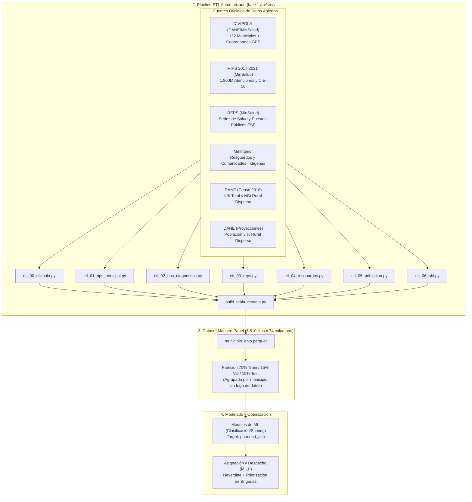
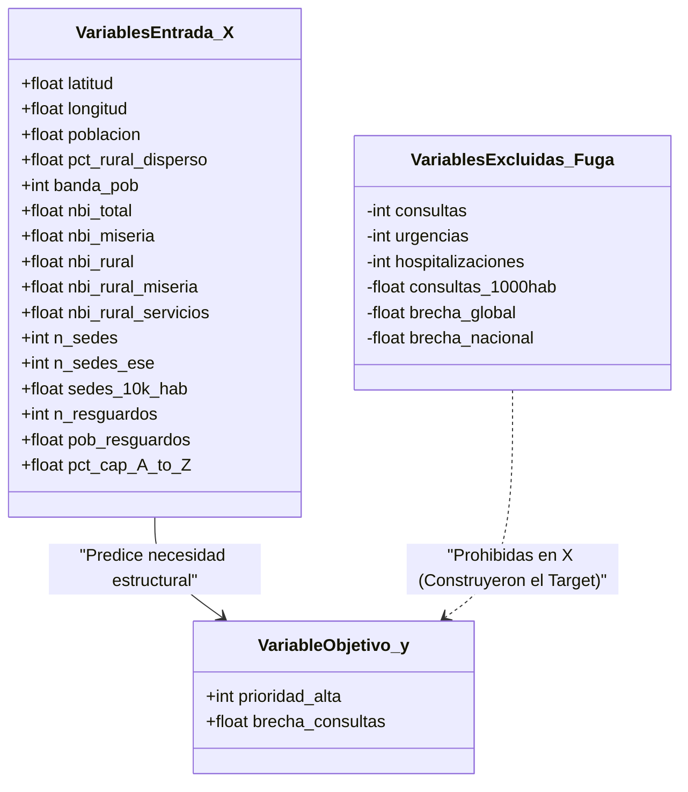

# Sistema Inteligente de Priorización y Optimización Espacial de Brigadas de Salud Extramurales

**Proyecto de Aula — Inteligencia Artificial (Séptimo Semestre)**  
**Universidad Popular del Cesar (UPC)**  
Facultad de Ingenierías y Tecnologías — Ingeniería de Sistemas e Informática  
Valledupar, Cesar — 2026

**Equipo de Desarrollo:**
* Jorman David Noriega Dávila
* Julio César Ríos Maldonado
* Gabriel Omar Venegas González

**Docente:** Tonny Jiménez

---

## 1. Planteamiento del Problema y Justificación

En Colombia, las comunidades rurales dispersas y los resguardos indígenas enfrentan barreras estructurales graves para acceder a la atención médica de primer nivel. Factores como la distancia geográfica, la falta de infraestructura fija de salud y altos niveles de Necesidades Básicas Insatisfechas (NBI) impiden que estas poblaciones reciban atención oportuna.

Históricamente, las Secretarías de Salud y las Empresas Sociales del Estado (ESE) despliegan **brigadas de salud extramurales** bajo criterios empíricos, presupuestos históricos o solicitudes informales, generando:
1. **Inequidad asistencial:** Zonas de extrema miseria quedan desatendidas por invisibilidad estadística.
2. **Incompatibilidad operativa:** Desplazamiento ineficiente de personal médico y vehículos hacia zonas con menor urgencia.
3. **Ausencia de previsibilidad:** Incapacidad de anticipar perfiles diagnósticos y déficit crónico en la atención primaria.

Este proyecto implementa una **solución híbrida de Inteligencia Artificial (Predictiva y Prescriptiva)** que:
* **Fase Predictiva (Machine Learning):** Identifica y clasifica objetivamente los municipios con déficit crítico de atención ambulatoria frente a sus pares poblacionales.
* **Fase Prescriptiva (Investigación de Operaciones / MILP):** Optimiza la asignación y el despacho de las brigadas médicas móviles utilizando coordenadas geográficas y restricciones logísticas.



---

## 2. Fuentes de Datos Oficiales Integradas

El proyecto utiliza exclusivamente datos abiertos oficiales del Estado Colombiano:

| Fuente | Entidad | Identificador / Archivo | Granularidad / Cobertura |
|---|---|---|---|
| **DIVIPOLA** | DANE / MinSalud | API Socrata `gdxc-w37w` | 1.122 municipios, con coordenadas GPS (latitud y longitud). |
| **RIPS** | Ministerio de Salud | API SODA v3 `4k9h-8qiu` | Consultas, urgencias, hospitalizaciones y 21 capítulos CIE-10 (2017–2021). |
| **REPS** | Ministerio de Salud | API SODA v3 `c36g-9fc2` | Capacidad instalada: sedes totales y sedes públicas (ESE). |
| **Resguardos** | MinInterior / DANE | API SODA v3 `epzt-64uw` / `fmd2-kgwe` | Resguardos indígenas, población protegida y comunidades fuera de resguardo. |
| **Pobreza NBI** | DANE (Censo 2018) | `CNPV-2018-NBI-DIVIPOLA-2021.xlsx` | Vulnerabilidad multidimensional general y específica para **rural disperso**. |
| **Población** | DANE | `PPED-AreaMun-2018-2042_VP.xlsx` | Proyecciones municipales oficiales y porcentaje rural disperso. |

---

## 3. Formulación Matemática de la Brecha y Target de IA

Para evitar comparar un municipio rural de 5.000 habitantes con una metrópoli como Bogotá o Medellín, el target se modeló mediante un **benchmark por pares poblacionales**:

1. **Estratificación por quintiles poblacionales (`banda_pob`):** Los municipios se agrupan en 5 bandas según su volumen de población.
2. **Tasa de consultas por 1.000 habitantes:**
   $$\text{tasa} = \frac{\text{consultas}}{\text{población}} \times 1.000$$
3. **Benchmark local:** Se calcula la mediana de la tasa para cada quintil de población y año ($\text{bench}_{\text{banda}, \text{año}}$), con *winsorización* al percentil 99 para evitar distorsiones por valores atípicos.
4. **Target continuo (Brecha de consultas):**
   $$\text{brecha\_consultas} = \max\left(0, 1 - \frac{\text{tasa}}{\text{bench}_{\text{banda}, \text{año}}}\right)$$
5. **Detección y aislamiento de centros hospitalarios de referencia (*Hubs*):**
   * Si un municipio registra una tasa $\ge 3\times$ la mediana de su estrato, se clasifica como `es_hub = 1` (atiende pacientes remitidos de otros municipios).
   * Los *hubs* se conservan en la base pero **se excluyen del ranking de priorización** para no sesgar las brigadas hacia grandes centros urbanos.
6. **Target binario (`prioridad_alta`):**
   $$\text{prioridad\_alta} = \begin{cases} 1 & \text{si } \text{brecha\_consultas} \ge p_{66} \text{ y } \text{es\_hub} \neq 1 \\ 0 & \text{en otro caso} \end{cases}$$

---

## 4. Partición de los Datos (Split 70 / 15 / 15)

Para garantizar un rigor científico total y evitar el **Data Leakage (fuga de datos por autocorrelación temporal)**, la partición se realiza **agrupada por municipio (`cod_mpio`) y estratificada por la variable objetivo**:

* **Total de registros panel:** 5.610 filas (1.122 municipios $\times$ 5 años).
* **70% Entrenamiento (`train`):** 785 municipios completos $\rightarrow$ **3.925 registros panel (70.0%)**.
* **15% Validación (`val`):** 168 municipios completos $\rightarrow$ **840 registros panel (15.0%)**.
* **15% Evaluación a ciegas (`test`):** 169 municipios completos $\rightarrow$ **845 registros panel (15.1%)**.

Al separar municipios enteros con todos sus años históricos, el modelo en validación y prueba se enfrenta a **territorios completamente desconocidos**, evaluando su capacidad real de generalización.

---

## 5. Estructura del Repositorio

```text
Proyecto IA/
│
├── README.md                                <- Documentación técnica principal del proyecto
├── Fases_Proyecto_Aula_IA (1).pdf           <- Rúbrica oficial y directrices de la asignatura
├── CNPV-2018-NBI-DIVIPOLA-2021.xlsx        <- Censo DANE 2018 oficial (Medida NBI)
│
├── fase 1/                                  <- Entrega inicial (propuesta formal)
│   ├── FASE I PROYECTO IA 2.pdf             <- Documento formal de propuesta aprobado (9 págs)
│   ├── Diagrama de Gantt del proyecto.png   <- Cronograma de trabajo
│   ├── generar_dataset.py                   <- Generador sintético exploratorio inicial
│   └── eda_dataset.ipynb                    <- EDA inicial sobre datos simulados
│
└── fase 1 api/                              <- Pipeline definitivo con datos reales abiertos
    ├── config/
    │   └── fuentes.json                     <- Endpoints SODA y configuración del pipeline
    ├── data/
    │   ├── raw/                             <- Archivos Excel originales DANE (NBI y Población)
    │   ├── processed/                       <- Tablas intermedias normalizadas (DIVIPOLA, REPS, NBI, etc.)
    │   └── modelo/
    │       ├── municipio_anio.csv           <- Dataset final consolidado (5.610 filas x 74 cols)
    │       └── municipio_anio.parquet       <- Dataset optimizado en formato columnar Parquet
    ├── docs/
    │   └── diccionario_datos.md             <- Diccionario exhaustivo de las 74 variables
    ├── logs/                                <- Trazabilidad y registros de ejecución del ETL y EDA
    └── src/
        ├── common.py                        <- Utilidades compartidas, peticiones y logging
        ├── etl_00_divipola.py               <- Extracción DIVIPOLA con coordenadas GPS corregidas
        ├── etl_01_rips_principal.py         <- Extracción de atenciones RIPS (consultas, urgencias)
        ├── etl_02_rips_diagnostico.py       <- Agregación de capítulos CIE-10
        ├── etl_03_reps.py                   <- Extracción de infraestructura instalada de salud
        ├── etl_04_resguardos.py             <- Extracción de resguardos y comunidades indígenas
        ├── etl_05_poblacion.py              <- Serie de población y ruralidad DANE
        ├── etl_06_nbi.py                    <- Procesamiento de pobreza NBI Censo 2018
        ├── build_tabla_modelo.py            <- Fusión maestra, cálculo de brecha y Split 70/15/15
        └── eda.py                           <- Reporte estadístico y análisis de calidad de datos
```

---

## 6. Guía de Ejecución y Reproducibilidad

### 6.1 Requisitos

* **Python 3.11.9** (versión con la que se generaron los modelos `.joblib`).
* **Git** para clonar el repositorio.
* Opcional: **MiKTeX** o **TeX Live** solo si se desea recompilar `documento.tex`; el PDF ya está incluido.

Las versiones exactas de las librerías están fijadas en [`fase 1 api/requirements.txt`](fase%201%20api/requirements.txt).

### 6.2 Instalación desde cero (Windows PowerShell)

```powershell
git clone https://github.com/JormanNoriega/Proyecto-IA.git
cd "Proyecto-IA\fase 1 api"

python -m venv .venv
.\.venv\Scripts\Activate.ps1
python -m pip install --upgrade pip
pip install -r requirements.txt
```

En Linux/macOS la activación es `source .venv/bin/activate`; el resto de comandos es equivalente.

### 6.3 Reconstruir el pipeline ETL (opcional)

Los datos procesados ya están versionados en `data/`, por lo que este paso **no es necesario** para ejecutar la demo o el modelado. Solo se requiere para regenerar todo desde las APIs:

```bash
# Ubicado en "fase 1 api"
python "fase 1/src/etl_00_divipola.py"
python "fase 1/src/etl_01_rips_principal.py"
python "fase 1/src/etl_02_rips_diagnostico.py"
python "fase 1/src/etl_03_reps.py"
python "fase 1/src/etl_04_resguardos.py"
python "fase 1/src/etl_05_poblacion.py"
python "fase 1/src/etl_06_nbi.py"

# Construir la tabla final de modelado con split 70/15/15
python "fase 1/src/build_tabla_modelo.py"

# Generar el reporte estadístico EDA
python "fase 1/src/eda.py"
```

### 6.4 Fase 2: modelado, optimización y demo

```bash
# Ubicado en "fase 1 api"
# Entrenamiento, GridSearch y evaluación de los 4 modelos (~ minutos)
python "fase 2/src/modelado.py"

# Resolver el MILP y generar el plan de brigadas del Cesar
python "fase 2/src/optimizacion_milp.py"

# Consultar cualquier municipio con el modelo ya entrenado
python "fase 2/src/probar_ia.py" "Pueblo Bello"
```

`probar_ia.py` carga el modelo y el dataset versionados, por lo que funciona **sin reentrenar**. Si se ejecuta sin argumentos, muestra dos casos de ejemplo (Pueblo Bello y Valledupar).

> **Nota:** todos los scripts localizan la raíz del proyecto a partir de su propia ubicación (`common.py`), así que funcionan sin importar la carpeta donde se clone el repositorio y sin rutas absolutas.

---

## 7. Matriz de Variables de Entrenamiento (Contexto vs. Fuga de Datos)


